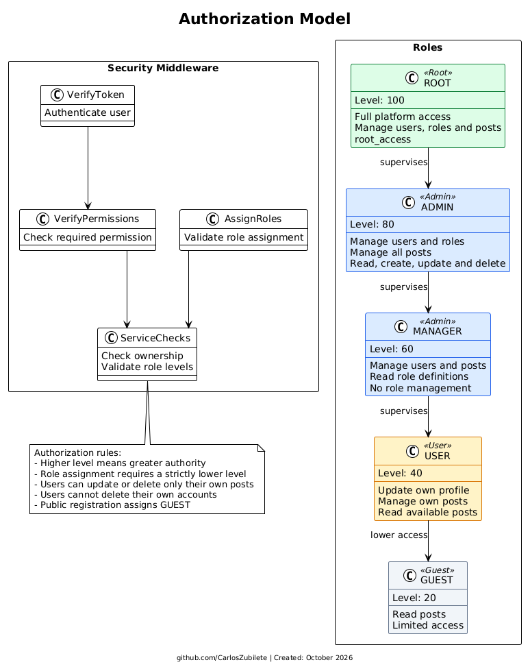

# Authorization and Authentication Flow

This document explains how the service checks a user's identity and access rights before allowing access to protected resources.

## How the flow works

1. **Authentication:** `VerifyToken` checks the user's token. If the token is valid, the service identifies the user and continues. If the token is missing, invalid, or expired, the request is rejected.
2. **Authorization:** `VerifyPermissions` checks whether the user has the permission required by the route.
3. **Role assignment:** `AssignRoles` checks that a user cannot assign a role with the same or a higher level than their own role.
4. **Service checks:** The service checks ownership and other business rules before completing the request.

## Role levels

Higher levels have greater authority:

- **ROOT (100):** Full access to the platform, including users, roles, and posts.
- **ADMIN (80):** Manages users, roles, and all posts.
- **MANAGER (60):** Manages users and posts, but cannot manage roles.
- **USER (40):** Updates their own profile and manages their own posts.
- **GUEST (20):** Has limited access and can read posts.

The [authorization model source](../plantuml/authorization_model.puml) contains the detailed UML definition of these roles, middleware checks, and authorization rules.

## Main security rules

- A higher role level means greater authority.
- A user can assign only a role with a lower level than their own.
- Users can update or delete only their own posts.
- Users cannot delete their own accounts.
- Public registration assigns the `GUEST` role.
